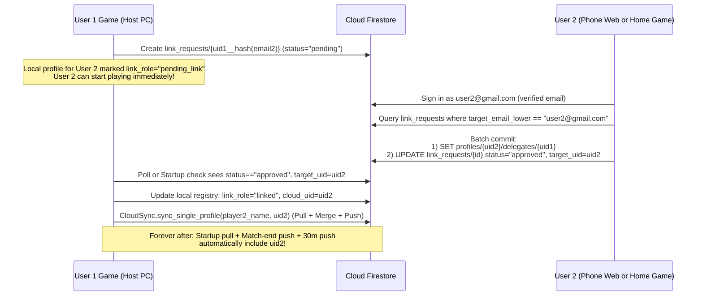

# Work Package 04 — Linked (Secondary) Accounts & Delegation

> **Prerequisite:** Read [`00_OVERVIEW.md`](00_OVERVIEW.md), [`01_FIREBASE_BACKEND_SCHEMA_RULES.md`](01_FIREBASE_BACKEND_SCHEMA_RULES.md), and [`03_PROFILE_IDENTITY_AND_CLOUD_SYNC.md`](03_PROFILE_IDENTITY_AND_CLOUD_SYNC.md).
> **Depends on:** Package 03 (`CloudSync` multi-profile sync engine and `CloudLinkSection` container in `players_menu.gd`).
> **Owns:** `Utils/Cloud/link_service.gd`, Linked-Account UI in `UI/PlayersMenu/players_menu.gd` (inside `CloudLinkSection` and an Approvals modal), `tests/test_linked_accounts_delegation.gd`.

---

## 1. Scope & Goals

Enable the "visiting friend" workflow (Requirement G6):
- `user1@gmail.com` is the primary signed-in user on `user1`'s simulator PC.
- `user2@gmail.com` comes over to play at `user1`'s house.
- The **first time** `user1` links `user2`'s profile by email, a link request is created in Firestore (`link_requests/{requestId}`).
- `user2` approves the request **once** — either on the Heckle Golf website on their phone right there (Package 06) or inside their own game client.
- Once approved, `user2`'s client/website writes `profiles/{uid2}/delegates/{uid1}`.
- From that moment on, `user1`'s machine automatically **pulls** `user2`'s stats on startup and **pushes** `user2`'s new shots/matches/achievements after every match and every 30 minutes **forever** without `user2` ever needing to sign in or re-approve on `user1`'s machine.
- When `user2` goes home and opens the game on their own PC, startup sync pulls all the stats and club averages recorded at `user1`'s house.
- Either `user2` (the owner) or `user1` (the host) can revoke the link at any time.

---

## 2. End-to-End Sequence



---

## 3. Edge Cases & Holes Addressed

1. **Email Spoofing Prevention (Hole H7):**
   - Firestore rules require `request.auth.token.email_verified == true` for `user2` to read or approve a `link_request` addressed to `target_email_lower`.
   - If `user2` signed up with Email/Password and hasn't verified their email yet, both the in-game Approvals UI and the Website Approvals tab prompt them with a **"Send Verification Email"** + **"I've Verified — Refresh"** button before enabling the **Approve** button. (Google Sign-In accounts have `email_verified == true` automatically.)
2. **Playing Before Approval Completes (Hole H8):**
   - `user2` does **not** have to wait for approval before teeing off at `user1`'s house!
   - If `user1` creates a local profile `"Dave"` with email `user2@gmail.com` and clicks **"Request Cloud Link"**, `"Dave"` is immediately playable. Any shots and matches `"Dave"` plays while `status == "pending"` are recorded locally and marked dirty. As soon as `user2` approves (even mid-round or after the round), `CloudSync` merges `"Dave"`'s local shots with `profiles/{uid2}/sync/stats` so zero shots are lost.
3. **Display Name Collision on Host Device (Hole H1):**
   - When `user1` pulls `user2`'s cloud profile (`display_name: "Mike"`) and `user1` already has a different local profile named `"Mike"`:
   - If the request was initiated from a specific local profile row (e.g. `"Mike G"`), keep the local profile name `"Mike G"` and map its `cloud_uid = uid2` (while preserving `profiles/{uid2}.display_name = "Mike"` in the cloud so `user2`'s own display name isn't overwritten by `user1`'s local nickname!).
4. **Revocation Handling:**
   - When `user2` revokes access (deletes `profiles/{uid2}/delegates/{uid1}` and sets `link_requests/{id}.status = "revoked"`), the next time `user1`'s `CloudSync` attempts to read or write `profiles/{uid2}`, Firestore returns `403 PERMISSION_DENIED`.
   - `CloudSync` catches `403` on a `"linked"` profile, transitions that local profile's `link_role` from `"linked"` to `"revoked"` (local data remains intact on `user1`'s PC as an offline profile), and shows a non-intrusive toast: `"Cloud sync for {name} is no longer active (access revoked by owner)."`

---

## 4. `LinkService` API (`Utils/Cloud/link_service.gd`)

```gdscript
class_name LinkService
extends RefCounted

signal link_request_updated(player_name: String, status: String, cloud_uid: String)
signal incoming_requests_loaded(requests: Array[Dictionary])
signal active_delegates_loaded(delegates: Array[Dictionary])

#Deterministic ID: requester_uid + "__" + target_email.strip_edges().to_lower().sha256_text().substr(0, 20)
static func make_request_id(requester_uid: String, target_email: String) -> String

# Called by user1 (host) for a secondary local profile
func send_link_request(local_player_name: String, target_email: String) -> Dictionary

# Checks status of outgoing pending requests created by CloudAuth.get_uid();
# called on startup and every 10s while the "Waiting for Approval" modal is open (max 10 min).
func check_outgoing_requests() -> Array[Dictionary]

# Called by user1 to stop syncing a linked profile on this device
func unlink_secondary_profile_locally(local_player_name: String) -> Dictionary

# Called by user2 (account owner) to see who wants access to user2's stats
func fetch_incoming_link_requests() -> Array[Dictionary]
func fetch_active_delegates() -> Array[Dictionary]

# Called by user2 to approve or deny a request, or revoke an existing delegate
func approve_link_request(request_doc: Dictionary) -> Dictionary
func deny_link_request(request_doc: Dictionary) -> Dictionary
func revoke_delegate(delegate_uid: String, request_id: String = "") -> Dictionary
```

---

## 5. Players Menu UI Additions (`UI/PlayersMenu/players_menu.gd`)

1. **On Secondary Local Profiles (inside `CloudLinkSection` created by Package 03):**
   - If `link_role == "none"`:
     - Button: **`🔗 Link Guest Cloud Account`**
     - Clicking opens a compact dialog: pre-fills the profile's `email` (or prompts for `user2@gmail.com`), sends `link_service.send_link_request(player_name, email)`, and shows instructions:
       > *"Approval request sent to **user2@gmail.com**! Have them sign in at **heckle-golf-sim.web.app** on their phone (or in-game under Players → Manage Access) to approve once."*
       - Includes a **`Check Approval Now`** button and a 10-second auto-poll while the dialog stays open.
   - If `link_role == "pending_link"`:
     - Amber badge: **`⏳ Cloud Link Pending (user2@gmail.com)`** + **`[Check Status]`** + **`[Cancel]`**.
   - If `link_role == "linked"`:
     - Blue badge: **`🔗 Linked Cloud Account (user2@gmail.com)`** + **`[Sync Now]`** + **`[Unlink]`**.
2. **Top Bar Button: `🔑 Approvals & Shared Access` (for the signed-in primary user):**
   - Shows a notification dot if `fetch_incoming_link_requests()` returns any `status == "pending"` requests.
   - Opens the **Manage Shared Access Modal** with two sections:
     - **Pending Requests to Access Your Stats:** Lists `requester_name (requester_email)` with **`[Approve]`** and **`[Deny]`** buttons.
     - **Friends Approved to Sync Your Stats:** Lists active `profiles/{my_uid}/delegates` entries with a **`[Revoke Access]`** button.
3. **Full Controller & Gamepad Navigation (`00_OVERVIEW.md` §6):**
   - Every control inside `CloudLinkSection`, the **Link Guest Cloud Account** dialog (`LineEdit` wired to `VirtualKeyboardManager`, `Send Request`, `Check Status`, `Cancel` buttons), and the **Manage Shared Access Modal** (`Approve`, `Deny`, `Revoke Access`, `Close` buttons, with `follow_focus = true` on the `ScrollContainer`) must register with `UIFocusGuard`, set explicit `focus_neighbor_*` paths, and handle `ui_cancel` (B button / Escape).

---

## 6. Verification & Unit Tests

Create `tests/test_linked_accounts_delegation.gd`:
1. **Deterministic Request ID:** Verify `make_request_id("uid1", "  User2@Gmail.com ")` is case/whitespace-normalized and stable.
2. **Pending → Approved State Transition:** Simulate creating a pending link on profile `"Dave"`, recording 3 driver shots while pending, receiving `"approved"` with `target_uid = "uid_dave"`, and verifying that `CloudSync` transitions `"Dave"` to `link_role == "linked"`, `cloud_uid == "uid_dave"`, and merges all 3 pre-approval shots into the cloud payload.
3. **Host Display-Name Preservation:** Verify that when `user1` syncs `user2`'s profile, `profiles/{uid2}.display_name` is preserved as `user2`'s cloud display name unless `user2` is the owner editing their own profile.
4. **Revocation Graceful Degradation:** Simulate a `403 PERMISSION_DENIED` response on `profiles/{uid2}` during `CloudSync` and assert that `"Dave"` becomes `link_role == "revoked"` without deleting local shots or failing `user1`'s primary profile sync.
5. **Controller Focus Navigation:** Verify that the **Manage Shared Access Modal** and **Link Guest Cloud Account** dialog register with `UIFocusGuard`, grab initial focus, and wire valid `focus_neighbor_*` paths across dynamic request rows.
