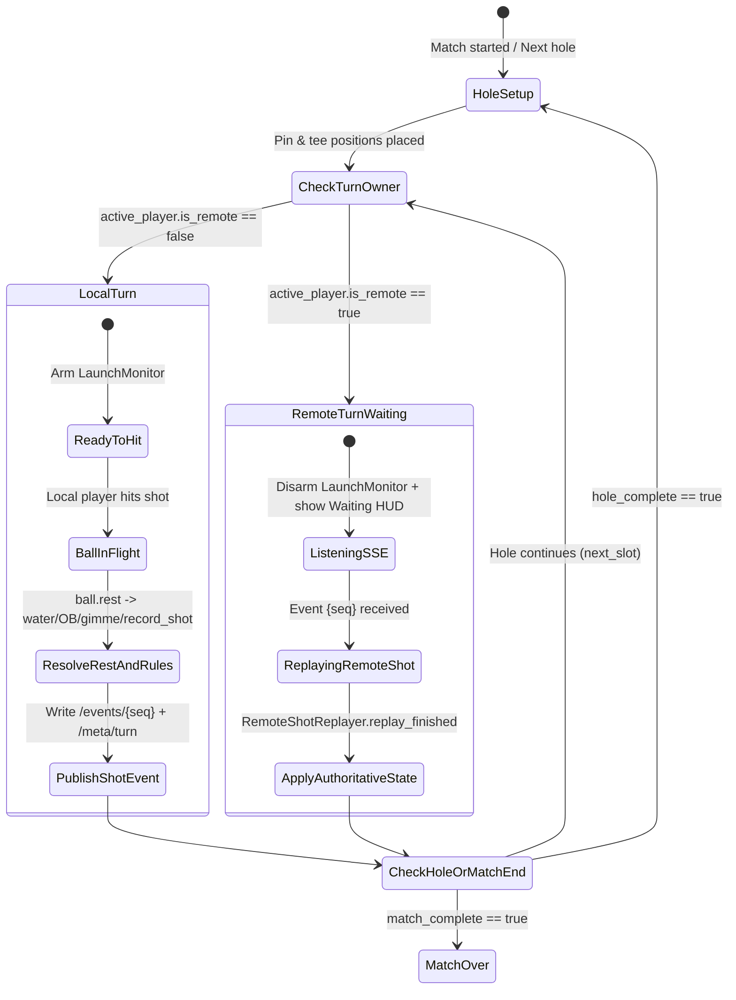

# Work Package 09 — Online Match Runtime: Turn Sync, Remote Replay Integration & Recovery

> **Prerequisite:** Read [`00_OVERVIEW.md`](00_OVERVIEW.md), [`01_FIREBASE_BACKEND_SCHEMA_RULES.md`](01_FIREBASE_BACKEND_SCHEMA_RULES.md), [`07_ONLINE_LOBBY_HOST_JOIN.md`](07_ONLINE_LOBBY_HOST_JOIN.md), and [`08_REMOTE_SHOT_REPLAY.md`](08_REMOTE_SHOT_REPLAY.md).
> **Depends on:** Package 07 (`OnlineSession` lobby handoff) and Package 08 (`RemoteShotReplayer`).
> **Owns:** `Utils/Cloud/online_match_controller.gd`, runtime extensions in `Utils/Cloud/online_session.gd`, minimal hooks in `Utils/MultiplayerManager.gd`, `Courses/Range/range.gd`, and `Courses/CoursePlay/course_play.gd`, `tests/test_online_match_runtime.gd`.

---

## 1. Scope & Goals

1. Transition cleanly from Package 07's lobby (`match_started`) into `course_play.tscn` / `range.gd` with synchronized course, hole list, wind, pin seed, gimme rules, and golfer order.
2. **Local Turn Flow:** When `active_player` belongs to **this device** (`owner_uid == CloudAuth.get_uid()`), enable normal launch monitor / manual hitting and normal physics. Once the ball comes to rest (and any water drop / gimme is resolved by `range.gd` and `MultiplayerManager.record_shot()`), publish one compact **Shot Event** (~400 bytes) to `/matches/{matchId}/events/{seqKey}` and update `/matches/{matchId}/meta/turn`.
3. **Remote Turn Flow:** When `active_player` is owned by a **remote device** (`is_remote == true`):
   - Lock local hitting and ignore stray launch monitor shots (Hole H18).
   - Display a clear HUD banner: **`"Waiting for {Player Name} to hit…"`** (with a `"Skip Inactive Player"` button if their device heartbeat is stale > 3 minutes, Hole H13).
   - When the remote player's shot event arrives via `RtdbStream` (or 2.5s fallback poll), replay the shot from `start` to `end` using Package 08's `RemoteShotReplayer` (ignoring tree/terrain collisions), then apply the authoritative state via `MultiplayerManager.record_remote_shot(event)` without polluting local club stats or achievements (Holes H9, H10).
4. **Match End & Sync:** When the final hole finishes, close the online session, restore any overridden local settings, and trigger `CloudSync` (Package 03) for all local synced profiles.

---

## 2. Turn State Machine



---

## 3. Minimal Additions to `MultiplayerManager.gd` (Holes H9, H10)

Keep edits in `Utils/MultiplayerManager.gd` small and self-contained:

### 3.1 Golfer Dictionary Fields in `setup_game()` (`L159–193`)
Accept optional metadata on each entry in `player_configs`:
- `"slot_id"`: `String` (e.g. `"slot_0"`)
- `"owner_uid"`: `String` (device UID that controls this golfer)
- `"cloud_uid"`: `String` (cloud profile UID if synced)
- `"is_remote"`: `bool` (`owner_uid != "" and owner_uid != CloudAuth.get_uid()`)

**Important guard in `setup_game()` (`L194`):**
```gdscript
if not p.get("is_remote", false):
    register_player(p_name, p_email, p_avatar, p_bag, config.get("tee", "Blue"), p_skill, p_handedness, p_ball_graphic)
```
Never register remote online opponents into the local device's `user://players_registry.json`!

### 3.2 Guarding Local Stat, Achievement & Match History Persistence (`L788–843`, `L2034–2238`)
1. Inside `record_shot()` (`L788`), if `active_player.get("is_remote", false)` is true, skip `record_global_shot`, `AchievementManager.check_shot_achievements`, and `AchievementManager.check_hole_achievements`.
2. Inside `_serialize_players()` (`L2148`, used by `save_current_match()` to write `user://match_history/*.json`):
   - **Only local players' stats and shot history are stored on disk.**
   - For any player with `p.get("is_remote", false) == true`, do **not** persist `shot_stats`, `shot_history`, or club metrics into `user://match_history/*.json` (persist only their basic `"name"`, `"is_remote": true`, `"total_strokes"`, and `"hole_scores"` so the local player's Win/Loss/Tie calculation in `calculate_player_stats()` still knows the match outcome without storing any remote player's shot data in local history).
3. In `calculate_player_stats(player_name)` (`L3661`):
   - Ignore any participant entry where `p.get("is_remote", false) == true` as a `target_player` (so you can never accidentally compute local player stats for a remote opponent's name), while still counting their `total_strokes` / `hole_scores` as an opponent when determining whether the local player won, lost, or tied the round.

### 3.3 Authoritative Remote Event Application: `record_remote_shot(event: Dictionary)`
Add `func record_remote_shot(event: Dictionary) -> void` to `MultiplayerManager.gd`:
1. Locate the golfer matching `event["slot_id"]` (or `active_player`).
2. Set `start_pos = _vec3_from_array(event["start"])` and `final_position = _vec3_from_array(event["end"])`.
3. Update in-memory turn state only (`active_player["last_starting_pos"] = start_pos`, `active_player["position"] = final_position`, `active_player["last_shot_club"] = event.get("club", "Dr")`, `active_player["lie_type"] = event.get("lie_end", "fairway")`).
4. Overwrite in-memory stroke counts and holed-out state from `event["scores"]` (shooter-authoritative, fixing Hole H10):
   - Set `active_player["strokes"] = int(slot_score["hole_strokes"])`
   - Set `active_player["total_strokes"] = int(slot_score["total_strokes"])`
   - Set `active_player["holed_out"] = bool(slot_score["holed_out"])`
   - Set `active_player["hole_scores"][hole_id] = active_player["strokes"]`
   - Do **not** record remote players' shots into `player_club_stats.json`, `players_registry.json`, `player_achievements.json`, `player_swing_issues.json`, or persistent `shot_stats` in `user://match_history/*.json`. Each device only records and syncs stats for the players playing locally on that device.
5. If `int(event.get("gimme_strokes", 0)) > 0`, emit `gimme_awarded.emit(active_player, int(event["gimme_strokes"]))`.
6. Emit `shot_recorded.emit(active_player, {})` and `distance_queue_updated.emit()`.
7. Advance turn/hole using the shooter's authoritative result:
   - If `bool(event.get("hole_complete", false))`:
     - Run skin/CTP evaluation if applicable and emit `hole_completed.emit(players)`.
   - Else:
     - Set `active_player_index` to the player matching `event["next_slot"]` and emit `active_player_changed.emit(get_active_player())`.

---

## 4. Synchronizing Pins, Wind, Settings & UI Restrictions

### 4.1 Deterministic Pin & Wind Setup (Holes H11, H27)
When `OnlineMatchController` starts an online match:
1. Snapshot the local user's settings (`wind_enabled`, `wind_speed`, `green_speed`, `random_pin_enabled`, `gimme_range_1..3`, `ball_rollout_enabled`, `turn_order_mode`) into `_saved_local_settings` so they can be restored when the match ends.
2. Apply `match_meta.settings` to `GlobalSettings.range_settings`.
3. Set `GlobalSettings.current_wind_speed_mph = match_meta.settings.wind_speed_mph` and `GlobalSettings.current_wind_direction_rad = match_meta.settings.wind_dir_rad`, and prevent `GlobalSettings.start_round_wind()` from re-rolling random wind while `OnlineSession.is_online_match` is true.
4. **Deterministic Random Pin Placement (`Courses/Range/range.gd` ~L4156):**
   - When `OnlineSession.is_online_match` is true and `random_pin_enabled` is true, seed a dedicated `RandomNumberGenerator` with `hash(str(match_meta.settings.pin_seed) + "_" + str(hole_id))` instead of using global `randf()` so every client computes the same random pin position on every hole.
   - As an extra safety belt (in case floating-point mesh raycasts vary slightly), the first shot event on each hole includes `"pin": [pin.x, pin.y, pin.z]`, and receivers snap `MultiplayerManager.set_current_pin_position(pin)` if it differs by `> 0.05m`.

### 4.2 Disabling Local-Only Mid-Match Mutations (Holes H16, H18)
While `OnlineSession.is_online_match == true`:
1. **Launch Monitor & Manual Hit Gate (Hole H18):**
   - In `Courses/Range/range.gd` (`_on_launch_monitor_hit_ball` L1923, `_on_tcp_client_hit_ball` L1904, `_on_range_ui_hit_shot` L2752, `_on_player_manual_hit` L2766):
   - If `OnlineSession.is_online_match and (MultiplayerManager.get_active_player().get("is_remote", false) or OnlineSession.is_replaying_remote_turn())`: ignore the input and return immediately.
2. **Course Play HUD Restrictions (`Courses/CoursePlay/course_play.gd`, Hole H16):**
   - Hide `mulligan_btn` (`L1695`).
   - Hide the `+ Add Player` and `Pause / Catch Up` controls in the Manage Players / Scorecard panels.
   - Change the Forfeit (`White Flag`) dialog text to **"Leave Online Match"** — confirming publishes a `"type": "leave"` event to `/matches/{matchId}/events/{seqKey}` (so remaining players immediately see `"Player X left the match"` and skip their future turns) and returns to the main menu.

---

## 5. Handling Disconnects, AFK Players & Rejoins (Hole H13)

1. **Event Queue & Sequential Ordering:**
   - `OnlineMatchController` tracks `_last_applied_seq: int = 0`.
   - Incoming events from `/matches/{matchId}/events` are buffered in a min-map keyed by `seq` and processed strictly in order (`_last_applied_seq + 1`, `_last_applied_seq + 2`, …).
   - If an event is received while a previous remote shot replay is still animating, call `replayer.skip_to_end()` or wait for `replay_finished` before starting the next replay so turns never overlap.
2. **AFK / Disconnected Active Player Skip:**
   - Each device updates `/matches/{matchId}/devices/{my_uid}/last_seen` every 60s.
   - If it is a remote golfer's turn and `now - devices[active_owner_uid].last_seen > 180` (3 minutes without heartbeat) OR `now - meta.turn.updated_at > 240` (4 minutes without hitting):
   - Show a **`"Player appears disconnected — [Concede Hole for Player] [Remove Player from Match]"`** button on the Waiting banner.
   - Clicking **`Concede Hole for Player`** writes an event `{"seq": next_seq, "type": "concede_hole", "slot_id": active_slot, ...}` which calls `MultiplayerManager.concede_hole()` on all clients and advances to the next active player.
   - Clicking **`Remove Player from Match`** writes `{"seq": next_seq, "type": "leave", "slot_id": active_slot, ...}` which marks `golfer.active = false` (`pause_player`) for the rest of the round.
3. **Crash / Rejoin Fast-Forward:**
   - Save `user://active_online_match.json` (`{"match_id": current_match_id, "joined_at": now}`) when a match starts, and delete it when the match finishes or the user leaves intentionally.
   - If the app restarts while `user://active_online_match.json` exists and `/matches/{matchId}/meta/status == "active"`, prompt: **`"Rejoin your online match in progress on {course_title}?"`**.
   - On rejoin, load the course, fetch all `/matches/{matchId}/events`, apply events `1..N-1` instantaneously (calling `record_remote_shot` without animation), and animate/resume at event `N`.
4. **Full Controller / Gamepad Navigation (`00_OVERVIEW.md` §6):**
   - Any interactive buttons on the **Waiting for Remote Player** banner (`Concede Hole for Player`, `Remove Player from Match`), the **Leave Online Match** confirmation dialog, and the **Rejoin Online Match** dialog must register with `UIFocusGuard`, set explicit `focus_neighbor_*` paths, grab focus automatically when shown, and support `ui_accept` / `ui_cancel`.

---

## 6. Verification & Unit Tests

Create `tests/test_online_match_runtime.gd`:
1. **Remote Shot Isolation (Hole H9):** Set up a 2-player online match (`slot_0` local, `slot_1` remote with `is_remote = true`). Apply a remote driver shot of 320 yards and a holed eagle putt via `record_remote_shot()`. Assert:
   - `slot_1`'s hole score and total strokes updated accurately.
   - `slot_1` was **not** added to `user://players_registry.json` or `user://player_club_stats.json`.
   - Zero achievements were unlocked in `AchievementManager`.
2. **Authoritative Turn & Score Snapshot Sync (Hole H10):** Simulate a remote shot event that includes `penalty: 1`, `gimme_strokes: 1`, `holed_out: true`, and `next_slot: "slot_0"`, and verify `active_player_index` advances to `slot_0` and `hole_scores` matches the event snapshot.
3. **Remote Turn Input Gate (Hole H18):** Verify that when `active_player.is_remote == true`, simulated launch monitor shot signals are ignored.
4. **Disconnect / Leave Event Handling (Hole H13):** Feed a `"type": "leave"` event for the active remote golfer and verify that `active` becomes `false` and the turn automatically advances to the local golfer.
